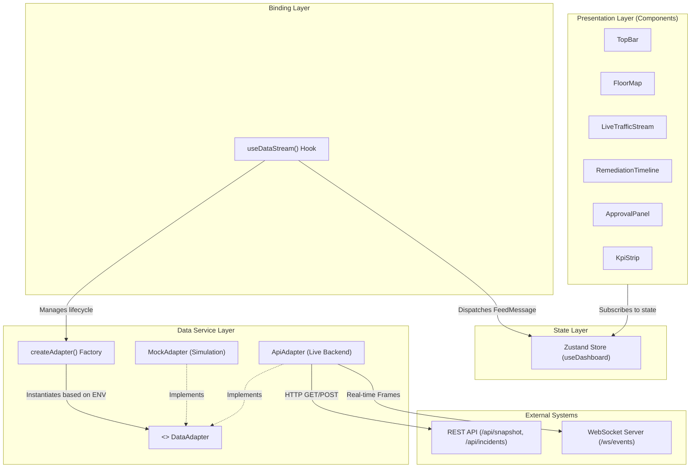

# ADR 001: Data Layer Adapter Pattern for Live Backend API Integration

- **Status**: Accepted
- **Date**: 2026-10-23
- **Deciders**: Frontend Engineering & Architecture Team
- **Context**: SwarmLink-M2M Command Center

---

## 1. Context and Problem Statement

The **SwarmLink-M2M Command Center** monitors autonomous triage and recovery across an edge swarm of ESP32 sensor nodes, a mobile robot doctor (Raspberry Pi middleware with a 5G modem), and an ACME oneM2M CSE cluster. 

During initial frontend development, an in-browser scripted simulation engine (`MockEngine`) was required to prototype and test real-time state transitions, floor plan mapping, guardrail escalation flows, and live traffic visualization without a live backend running.

Now, as the system transitions toward linking with the real production backend (e.g., FastAPI, oneM2M middleware, and WebSocket gateways):
- The frontend must completely decouple the UI view components from data origin.
- The user must be able to halt all random simulated ambient traffic and connect directly to live REST and WebSocket endpoints without modifying component code.
- Reconnecting, initial synchronization, error handling, and manual operator write actions (`approve` / `reject`) must follow a strict, standardized interface.

---

## 2. Decision: The DataAdapter Pattern

We adopted the **Adapter Pattern** with a central reactive unidirectional state store ([Zustand](file:///Users/likhithkanigolla/Personal/swarmlink-m2m-fe/src/store/dashboard.ts)).

All components subscribe exclusively to the Zustand dashboard store (`useDashboard`). Neither components nor store know or care whether data arrives from an in-browser generator, a local test harness, or live production microservices.

### Architectural Diagram



---

## 3. Interface Specification

The core abstraction defined in [`src/services/dataService.ts`](file:///Users/likhithkanigolla/Personal/swarmlink-m2m-fe/src/services/dataService.ts):

```typescript
export interface DataAdapter {
  /**
   * Starts ingestion and binds the callback dispatchers.
   * @param emit - Dispatches standard FeedMessages into the store.
   * @param onStatus - Updates connectivity state ('connected' | 'reconnecting' | 'disconnected' | 'mock').
   */
  start(emit: (m: FeedMessage) => void, onStatus: (s: ConnectionStatus) => void): void;

  /** Gracefully tears down open WebSockets or background timers. */
  stop(): void;

  /** Pauses/resumes incoming event processing. */
  setPaused(paused: boolean): void;

  /** Sends human operator triage approvals/rejections back to the backend. */
  decide(incidentId: string, approve: boolean): void;

  /** Preserved for mock scenario parity. */
  setSpeed(speed: number): void;
  setRoomCount(n: number): void;
}
```

### Protocol & Message Envelope

All stream transmissions use the typed `FeedMessage` envelope:

```typescript
export interface FeedMessage {
  type: 
    | "snapshot"     // Full initial state tree
    | "event"        // Unified traffic frame (CREATE, RETRIEVE, NOTIFY, PING)
    | "metric"       // KPI updates & sparklines
    | "room"         // Room health & device status array
    | "device"       // Individual device updates
    | "robot"        // Robot doctor telemetry & route
    | "queue"        // Virtual triage queue & detour notes
    | "incident"     // Remediation incidents & escalation status
    | "audit"        // AI guardrail logs
    | "tree"         // oneM2M ACME resource tree updates
    | "link"         // 5G RSRP/SINR telemetry & handover steps
    | "security"     // oneM2M ACP allow/deny logs
    | "subsystems"   // Subsystem health chips (IN-CSE, MN-CSE A/B, etc.)
    | "fl";          // Federated Learning status
  data: unknown;
}
```

---

## 4. How to Connect With Real APIs

### Step 1: Set Environment Variables

Create `.env.local` (or configure your deployment environment):

```env
# URL of your REST backend
VITE_API_URL=http://localhost:8000

# URL of your WebSocket event stream
VITE_WS_URL=ws://localhost:8000/ws/events
```

### Step 2: Runtime Adapter Switch

The factory function [`createAdapter()`](file:///Users/likhithkanigolla/Personal/swarmlink-m2m-fe/src/services/dataService.ts#L145-L147) automatically selects the adapter:

- If `VITE_API_URL` is set &rarr; Instantiates `ApiAdapter`. **The in-browser random simulation engine is completely disabled.**
- If `VITE_API_URL` is empty &rarr; Falls back to `MockAdapter`.

### Step 3: API Contracts Required on Backend

1. **Initial Snapshot (`GET /api/snapshot`)**:
   Returns HTTP 200 with the full JSON object matching the `Snapshot` interface:
   - `subsystems`: Health chips for `IN-CSE`, `MN-CSE A`, `MN-CSE B`, `5G Core`, etc.
   - `rooms`: Array of rooms and child ESP32 devices.
   - `robot`: Position, target room, battery, route.
   - `queue`: Ranked priority queue entries.
   - `incidents`: Open or in-progress remediation incidents.
   - `tree`: Hierarchical ACME oneM2M resource tree.
   - `link`: Current RSRP, SINR, threshold, and district.
   - `kpis`: Telemetry metrics for the KPI strip.
   - `catalog`: Remediation solution catalogue.

2. **Real-Time Stream (`WS /ws/events`)**:
   WebSocket connection that streams `FeedMessage` JSON strings:
   ```json
   { "type": "event", "data": { "id": "e1", "layer": "device", "protocol": "MQTT", ... } }
   { "type": "metric", "data": { "kpis": [...] } }
   ```
   The `ApiAdapter` includes automatic reconnection backoff (`RECONNECT_MS = 3000`) and live connection status indicator (`connected`, `reconnecting`, `disconnected`).

3. **Human Guardrail Approvals (`POST /api/incidents/{id}/approve` & `/reject`)**:
   - `POST /api/incidents/{id}/approve`: Operator approves an AI-proposed compound remediation action.
   - `POST /api/incidents/{id}/reject`: Operator rejects and escalates to manual field maintenance.

---

## 5. Consequences & Trade-offs

### Positive
- **Zero Component Coupling**: Modifying backend transport (e.g., switching from WebSocket to Server-Sent Events or gRPC-Web) requires changing only `ApiAdapter`. No UI components are touched.
- **Instant Deactivation of Simulation**: Setting `VITE_API_URL` guarantees that no random synthetic background events run.
- **Testability**: Facilitates deterministic unit and end-to-end testing by swapping adapters without complex HTTP mocking.
- **Resilience**: The UI gracefully reports connection drops and automatically resynchronizes state via snapshot upon reconnect.

### Considerations
- The backend WebSocket server must emit messages matching the `FeedMessage` type discriminators and property names.
