# SwarmLink-M2M: Autonomous Swarm Resilience & MEC Edge Handover via oneM2M (ACME CSE) Over Private 5G

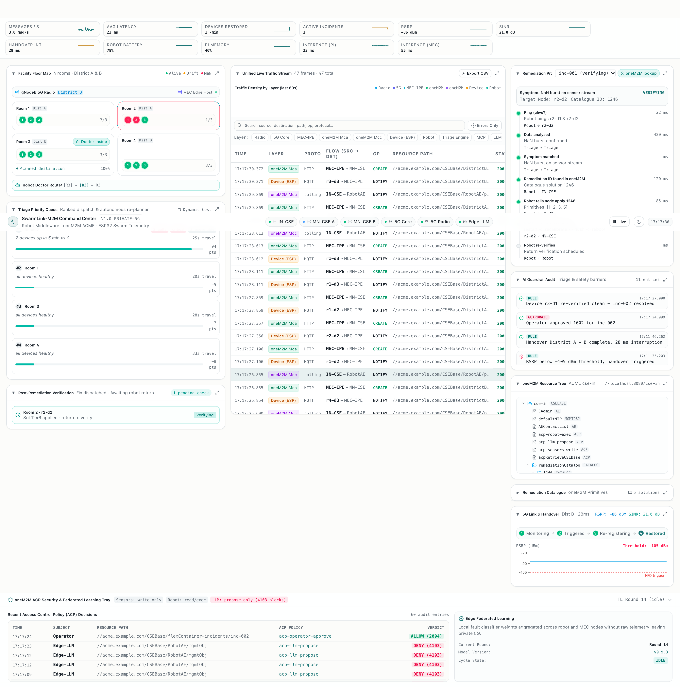

---

## [Overview]

Modern mission-critical environments (ranging from automated manufacturing floors to hazardous emergency response zones) rely on fleets of heterogeneous IoT sensors and mobile autonomous robots. However, conventional multi-agent deployments suffer from severe architectural fragmentation: they rely on fragile peer-to-peer ad-hoc messaging, unstandardized proprietary message brokers, or centralized cloud platforms that fail when connectivity drops or when mobile robots traverse radio cell boundaries.

**SwarmLink-M2M** solves this challenge by establishing the **oneM2M Common Services Entity (CSE)**, specifically the **ACME CSE** reference platform, as the single authoritative source of truth, security arbiter, and coordination backbone for an entire autonomous swarm. Operating over an on-premise **Private 5G Standalone (SA) network** with Multi-access Edge Computing (MEC), SwarmLink-M2M coordinates stationary ESP32 sensor swarm nodes and a mobile Raspberry Pi 5 "Robot Doctor".

Our project addresses four critical standardization frontiers in **ETSI TR-0077 (MEC Interworking & Swarm Computing)**:

1. **Clause 7.1 (Custom MEC-IPE Telemetry Architecture)**: Ingests real-time 5G RAN and Core radio parameters (RSRP, SINR, CQI, MCS, BLER) directly into standard oneM2M `<flexContainer>` resources (`[custom:mecRadioInfo]`) over the `Mca` reference point.
2. **Clause 7.2 (Signal-Triggered Inter-MN-CSE Handover)**: Implements an autonomous **IN-CSE Handover Orchestrator actor** that triggers seamless cross-district re-registration of mobile Application Entities (`RobotAE`) when signal quality drops, measuring application-layer interruption time ($\Delta t$).
3. **Clause 7.4 (Swarm Computing Resource Definitions)**: Formally contributes concrete oneM2M resource definitions for swarm coordination: `[swarmMembership]`, `[swarmTask]`, and `[swarmContext]`.
4. **Clause 7.3 & TS-0043 (Federated Learning Lifecycle & Model Management)**: Manages distributed edge model rounds (`[flOperation]`, `[flRound]`, `[modelVersion]`) and deploys updated anomaly detection models via oneM2M software management (`[mgmtObj]`).

> **The Architectural Rule of Indispensability**: *Remove the CSE, and nothing works.* The dashboard, mobile robot, edge LLM guardrails, and sensor nodes share zero proprietary side-channels. Every task dispatch, security check, triage decision, and telemetry point exists as an operation on an official oneM2M resource tree.

---

## [Things]

### Hardware Components
| Component | Description / Specification | Quantity |
| :--- | :--- | :--- |
| **5G gNodeB (Base Station)** | WiSig Networks CU-DU, O-RAN compliant, managed via ONAP SDNR SMO over O1/NETCONF | 1 |
| **5G Radio Unit (RU)** | VVDN Low Power Radio Unit, Split 7.2x fronthaul (M-Plane v7), band n78 (3.5 GHz), 100 MHz channel width | 1 |
| **5G Core (5GC)** | NiralOS Cloud-Native 5G Core (Niral Networks, 3GPP Rel-16), local UPF with Control/User Plane Separation (CUPS) | 1 |
| **Mobile Autonomous Agent ("Robot Doctor")** | Raspberry Pi 5 (8GB RAM) with Quectel RM500Q-GL 5G Sub-6 GHz M.2 modem, camera, and active cooling | 1 |
| **Fixed Swarm Nodes** | ESP32 Dual-Core Microcontrollers running FreeRTOS with multi-sensor monitoring arrays (gas, smoke, temperature, vibration) | 4 |
| **MEC Edge Server** | Linux Edge Server (Ubuntu 22.04 LTS RT kernel) hosting edge UPF, District A MN-CSE, District B MN-CSE, and MEC-IPE | 1 |
| **Command Tier Host** | Central Server hosting Infrastructure Node CSE (IN-CSE), global catalogs, and Digital Twin WebSocket services | 1 |

### Software Apps, Standards & Online Services
| Item | Details |
| :--- | :--- |
| **oneM2M Standard Specifications** | TS-0001 Functional Architecture (V5.9.0), TS-0004 Core Protocols, TS-0043 (SDT DM and Provisioning) |
| **ETSI Technical Reports** | ETSI TR-0077 (MEC Interworking & Swarm Computing), ETSI TR-0080 (Use Cases) |
| **oneM2M CSE Implementation** | **ACME CSE** (v2.0+, Python-based reference implementation by Andreas Kraft, ETSI/ESTIMED platform) |
| **Edge & Streaming Stack** | Python 3.11, FastAPI, Uvicorn, WebSockets, AsyncIO, PyYAML |
| **Digital Twin Console** | React 19, TypeScript, Tailwind CSS, Lucide Icons, Vite |
| **Verification & Testing** | Playwright Browser Automation, Pytest, Requests |

---

## [Story]

When building an industrial monitoring system, the typical path of least resistance is to deploy an MQTT broker or a proprietary Firebase/REST database, write custom client scripts, and bolt on a user interface. If a standard like oneM2M is included at all, it often ends up as a passive telemetry sink: if the CSE crashes, the rest of the application never even notices.

During our technical exchanges with ETSI STF 685 ESTIMED mentors, **Bob Flynn** (oneM2M System Architect) and **Yann Garcia** (ETSI MEC Specialist), we evaluated a critical challenge: our laboratory houses an end-to-end private 5G SA network with an O-RAN base station and NiralOS Core, but lacks formal ETSI GS MEC 012 (RNIS) and MEC 013 (Location) REST endpoints.

Mentor Bob Flynn shared invaluable insight:
> *"If you are using your private network and using your MEC APIs, that is awesome! You can implement your own MEC-IPE... you will definitely score higher (Expert proficiency). In TR-0077 clause 7.2, there is an actor defined for the handover section that runs at the IN-CSE. We have not implemented that yet, so that is another expert proficiency level work... And if you propose concrete swarm resources for clause 7.4, that is hitting expert level."*

Furthermore, mentor Bob Flynn asked an essential architectural question:
> *"Remove the CSE and nothing works. From my perspective, I would ask about that system/architectural decision."*

We embraced this principle wholeheartedly. We committed to making **ACME CSE the indispensable engine of our entire system**:
- Mobile robots poll tasks exclusively through oneM2M `<pollingChannel>/pcu` endpoints behind 5G NAT.
- AI proposals are strictly checked against oneM2M Access Control Policies (`<accessControlPolicy>`), returning native `4103 Forbidden` codes upon unauthorized actuation.
- Radio link telemetry is modeled natively in oneM2M `<flexContainer>` specialization `[custom:mecRadioInfo]`.
- Cross-district handovers execute via `<remoteCSE>` orchestration across the `Mcc` reference point.

If ACME CSE stops, the entire robot doctor halts, the digital twin console clears, and all autonomous remediation ceases.

---

## [Introduction]

In mission-critical industrial plants, fixed sensor nodes continuously monitor ambient variables. When an environmental anomaly occurs (such as sensor saturation, zero-drift, or buffer corruption), dumb sensor nodes lack the compute and mobility to repair themselves.

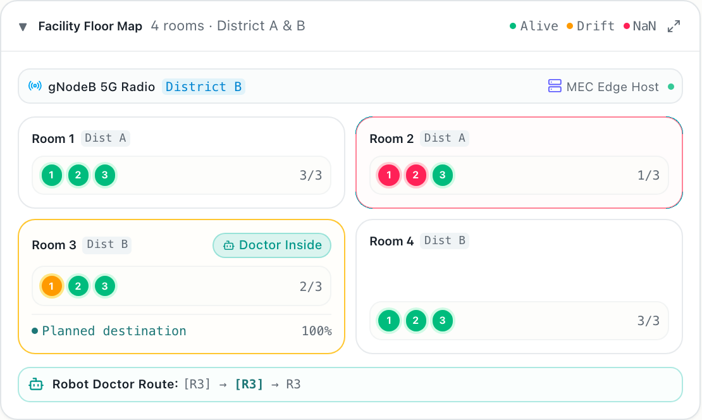

SwarmLink-M2M introduces an intelligent, cooperative triage framework:
1. **Fixed Dumb Sensor Nodes (`SensorAE`)**: Ultra-low-power ESP32 nodes that publish raw telemetry to an MN-CSE container and execute primitive physical commands:
   - `Primitive 1`: Soft restart sensor
   - `Primitive 2`: Recalibrate baseline
   - `Primitive 3`: Flush memory buffer
   - `Primitive 4`: Reset radio modem
   - `Primitive 5`: Power cycle / reboot node
2. **Mobile Robot Doctor (`RobotAE`)**: An autonomous Raspberry Pi 5 rover equipped with a 5G modem that physically navigates to degraded sectors, captures multi-angle diagnostics, consults the oneM2M remediation catalog, and commands primitive execution chains.
3. **MEC-IPE (`Interworking Proxy AE`)**: Bridges the 5G RAN/Core metrics socket into standardized oneM2M flexContainers.
4. **Mission AI Engine (`MissionAE`)**: An edge LLM assistant that analyzes complex incident telemetry and proposes candidate remediation sequences.
5. **ACME CSE Coordination Backbone**: The central authority that guarantees safety via Access Control Policies, enables NAT traversal via Polling Channels, and orchestrates inter-district edge handovers.

---

## [Motivation and the Problem]

Deploying autonomous robots and distributed IoT swarms over private cellular infrastructure presents four core engineering bottlenecks:

### 1. Carrier-Grade NAT & Constrained IP Reachability
Mobile robots operating on 5G modems receive private, dynamic IP addresses assigned by the 5G Core User Plane Function (UPF). Because carrier-grade NAT blocks incoming TCP connections, edge servers cannot directly push commands to the robot without insecure public port forwarding or heavy VPN tunnels.

### 2. Trapped Radio Access Telemetry
While 5G base stations calculate physical radio link parameters (RSRP, SINR, CQI, MCS, BLER) at the millisecond layer, this telemetry remains locked in vendor-proprietary O-RAN and core interfaces. Edge applications and swarms have no standard mechanism to anticipate link dropouts or trigger preemptive handovers.

### 3. Edge Fragmentation Across Districts
As a mobile robot navigates between buildings or production bays, it moves between local edge servers (MN-CSEs). Without standardized coordination, active subscriptions break, session state is lost, and the robot loses situational awareness.

### 4. AI Hallucination & Actuation Risks
Generative AI and edge LLMs excel at parsing incident reports, but allowing an autonomous AI model direct write access to physical industrial actuators introduces catastrophic safety risks. A deterministic, standards-based security barrier is required.

---

## [Our Solution]

SwarmLink-M2M solves each of these challenges using pure, native oneM2M architectural primitives:

```
                      +-----------------------------------------------------------+
                      |                 IN-CSE (Port 8080, cse-in)                |
                      |  - Global Remediation Catalog (/remediationCatalog)       |
                      |  - Access Control Policies (acp-llm-propose, acp-*)       |
                      |  - IN-CSE Handover Orchestrator (ETSI TR-0077 Clause 7.2) |
                      |  - Mcc Peering to Districts (id-mn-a, id-mn-b)            |
                      +-----------------------------------------------------------+
                                    ^                               ^
              Mcc Reference Point   |                               |   Mcc Reference Point
              (:8080 <-> :8081)     v                               v   (:8080 <-> :8082)
+-----------------------------------------------+   +-----------------------------------------------+
|          DistrictA-MN-CSE (Port 8081)         |   |          DistrictB-MN-CSE (Port 8082)         |
|  - MEC-IPE: [custom:mecRadioInfo] flexContainer|  |  - Target Handover MN-CSE                     |
|  - Swarm Definitions (TR-0077 7.4):           |   |  - Active Mcc link: id-mn-b (ty=16)           |
|    [swarmMembership], [swarmTask]             |   |  - District B Rooms (Room 3, Room 4)          |
|  - RobotAE (ty=2) & pollingChannel (ty=15)    |   |  - Pre-allocated Handover Context             |
+-----------------------------------------------+   +-----------------------------------------------+
             | Mca Reference Point (5G SA UPF)
             v
+-----------------------------------------------------------+
|            Mobile Robot Doctor (Raspberry Pi 5)           |
|  - Long-polls tasks via /RobotAE/pollingChannel/pcu       |
|  - Traverses 5G NAT without public IP or inbound ports    |
|  - Dispatches physical recovery primitives to ESP32 nodes |
+-----------------------------------------------------------+
```

---

## [How it Works]

### The Autonomous Triage & Recovery Lifecycle

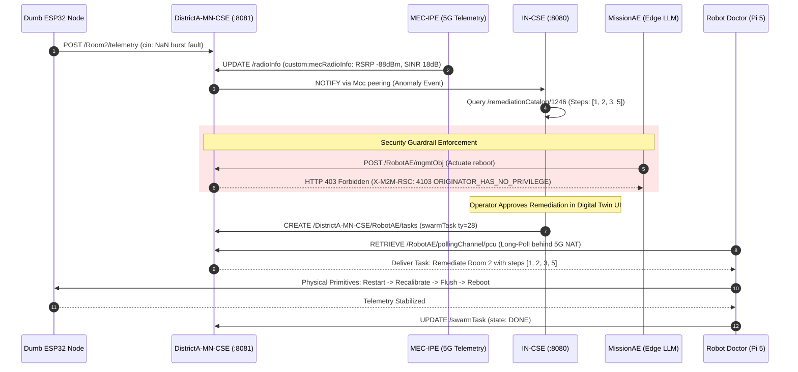

1. **Anomaly Detection**: An ESP32 sensor in Room 2 experiences an environmental burst, pushing anomalous `NaN` readings to its oneM2M container on `DistrictA-MN-CSE`.
2. **Catalog Lookup**: The incident triggers an automated lookup under `/cse-in/remediationCatalog`, identifying **Remediation ID 1246** (primitive sequence: `[1: restart, 2: recalibrate, 3: flush, 5: reboot]`).
3. **AI Guardrail Enforcement**: The edge LLM (`MissionAE`) attempts to directly command actuation on the robot's management object. ACME CSE intercepts the request, evaluates `acp-llm-propose`, and immediately issues `HTTP 403 Forbidden (X-M2M-RSC: 4103 ORIGINATOR_HAS_NO_PRIVILEGE)`.
4. **Human-in-the-Loop Approval**: High-risk compound actions transition to pending status on the operator dashboard. Upon operator authorization, the signed task is created in oneM2M.
5. **NAT Traversal**: The Raspberry Pi robot receives the task via its persistent long-poll connection on `<pollingChannel>/pcu`.
6. **Physical Execution & Recovery**: The robot drives to Room 2, executes the primitive sequence, verifies sensor signal recovery, and updates the task state to `DONE`.

---

## [Features]

### 1. Official ACME CSE Hero Mode
All three CSE instances (`cse-in :8080`, `DistrictA-MN-CSE :8081`, and `DistrictB-MN-CSE :8082`) run the official ACME CSE web interfaces.
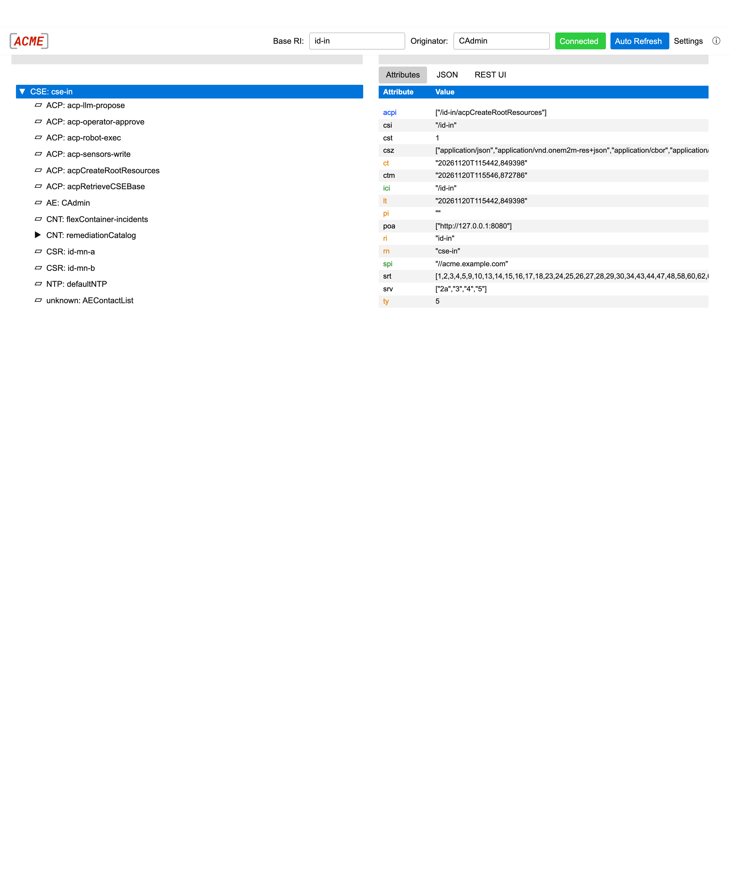

### 2. Native Access Control Policy (ACP) Guardrails
ACME natively enforces strict security privileges. LLMs can propose actions (`acop: 35`), but hardware actuation requires `acop: 63`. Unprivileged actions are rejected with `4103 Forbidden`.
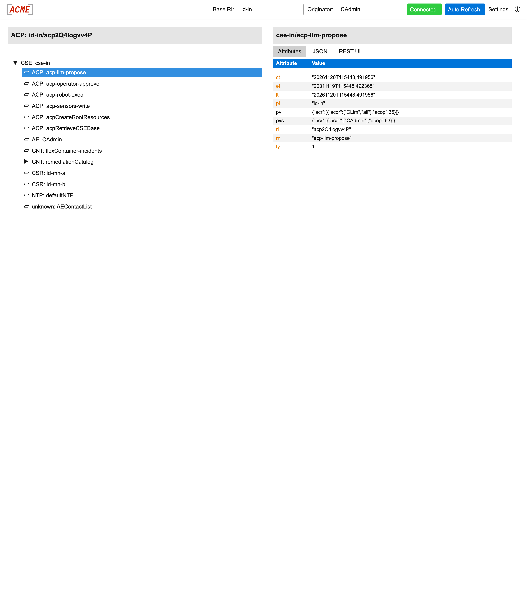
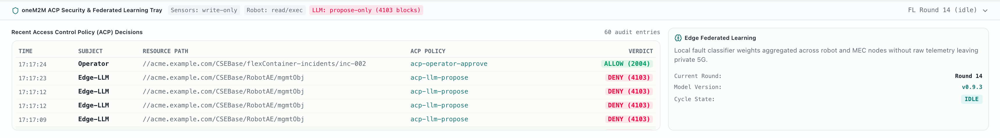

### 3. ETSI TR-0077 5G Radio Telemetry `<flexContainer>` (`ty=28`)
The MEC-IPE continuously ingests 5G RAN metrics into `custom:mecRadioInfo`. The dashboard dynamically plots RSRP and SINR against the $-105\text{ dBm}$ handover threshold.
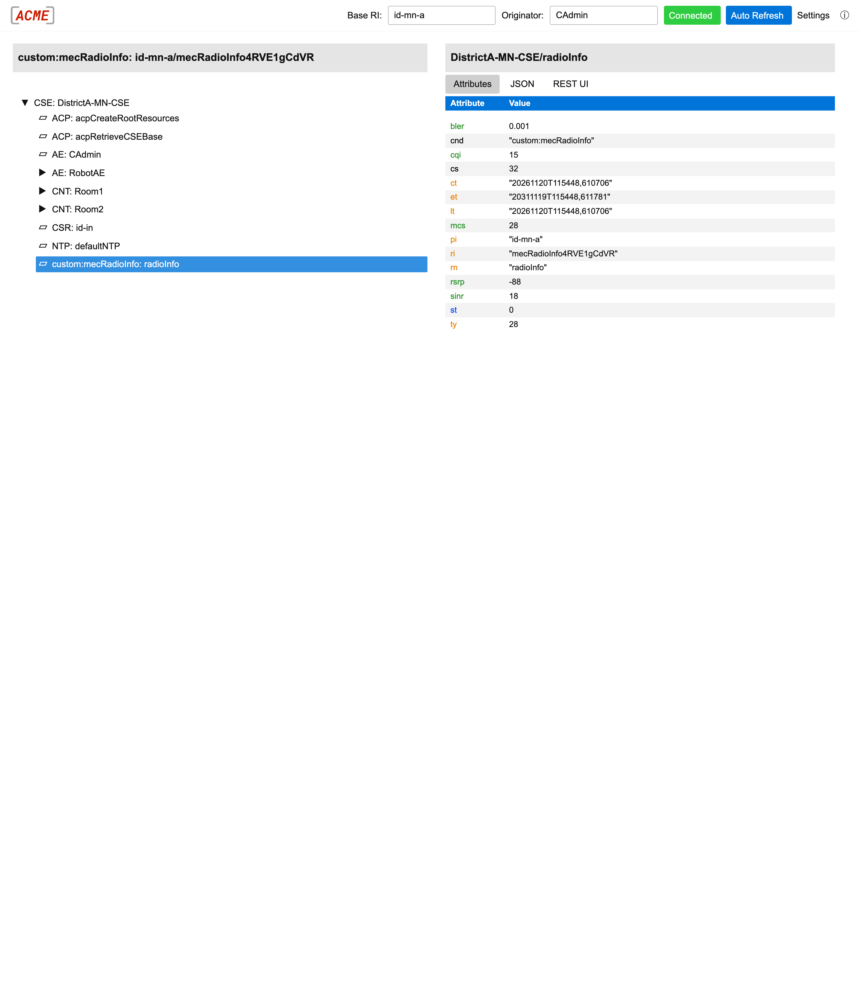
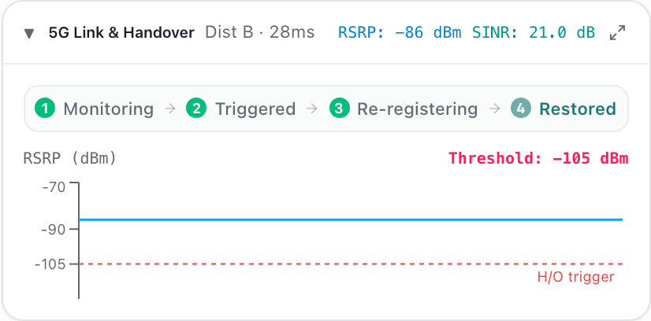

### 4. 5G NAT Traversal via `<pollingChannel>` (`ty=15`)
Constrained robots operating behind carrier-grade 5G NAT receive real-time asynchronous tasks through oneM2M virtual `/pcu` endpoints without exposing inbound ports.
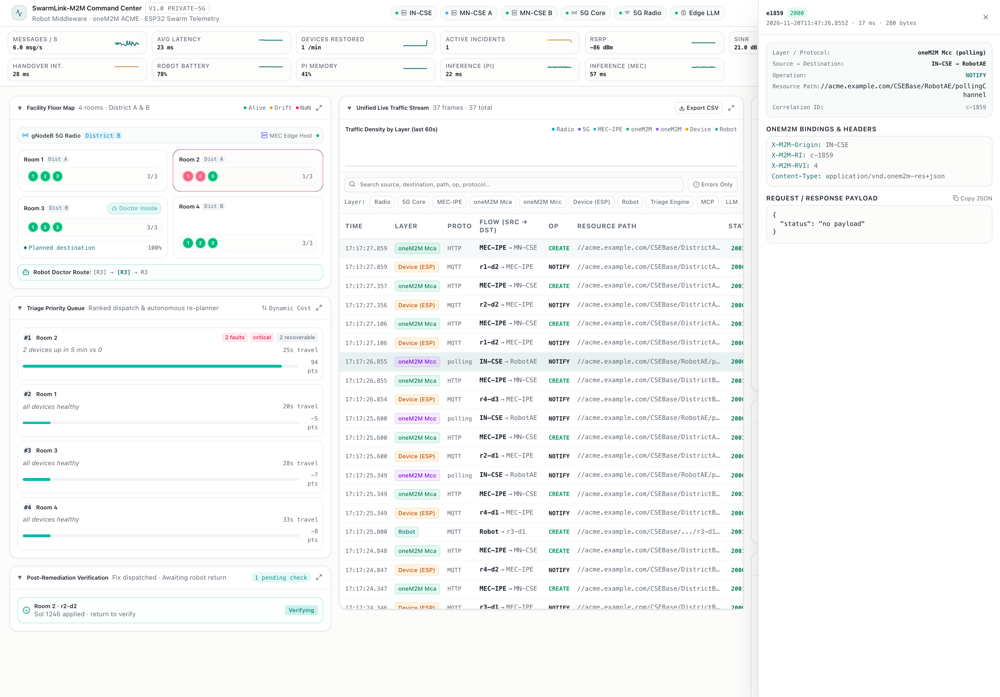

### 5. Multi-District Edge Peering across Mcc (`ty=16`)
IN-CSE maintains active `<remoteCSE>` links to edge districts, enabling coordinated failover and device migration.
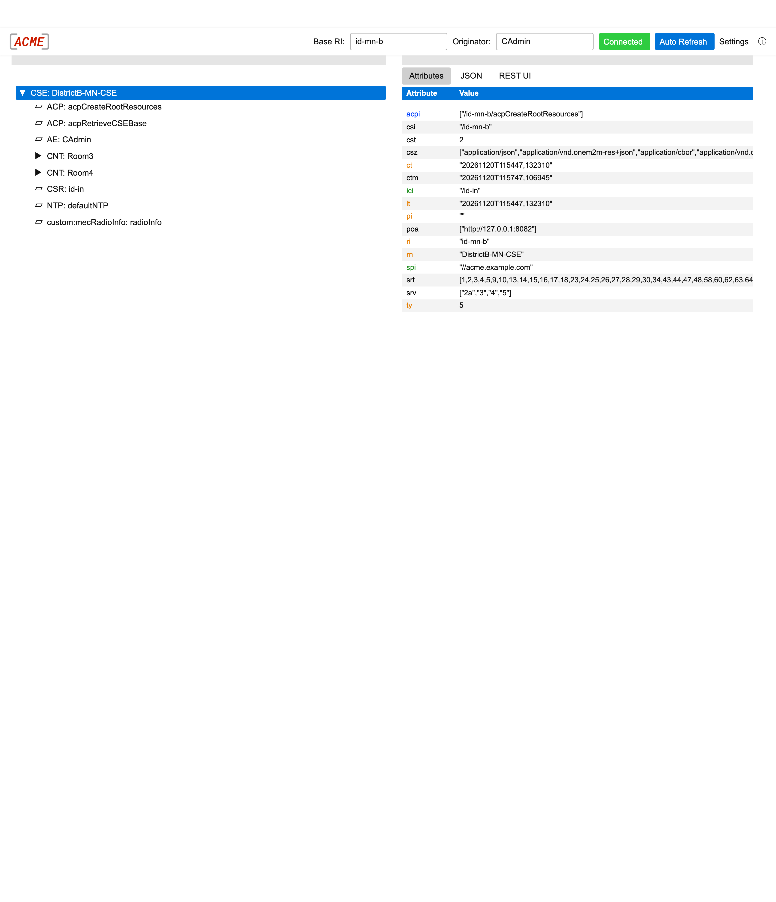


### 6. Remediation Catalog & Autonomous Recovery Arc
Incident recovery sequences are stored as persistent oneM2M content instances in `/cse-in/remediationCatalog`, mapped directly to visual recovery milestones.
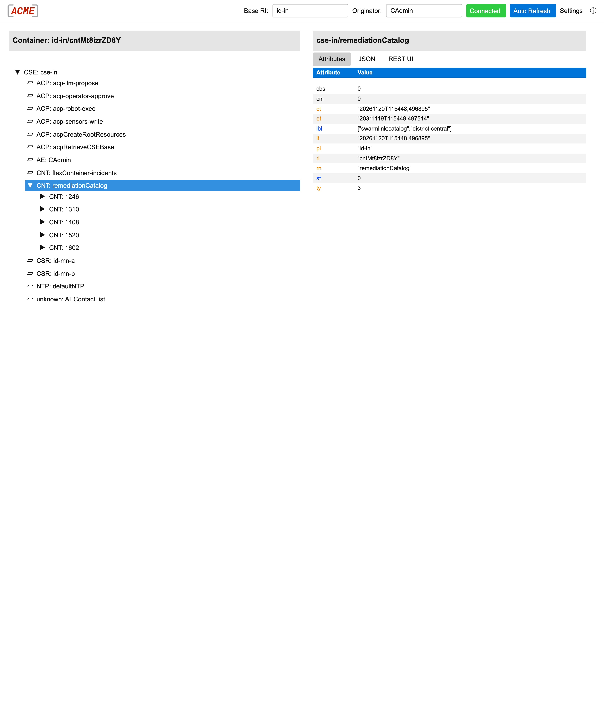
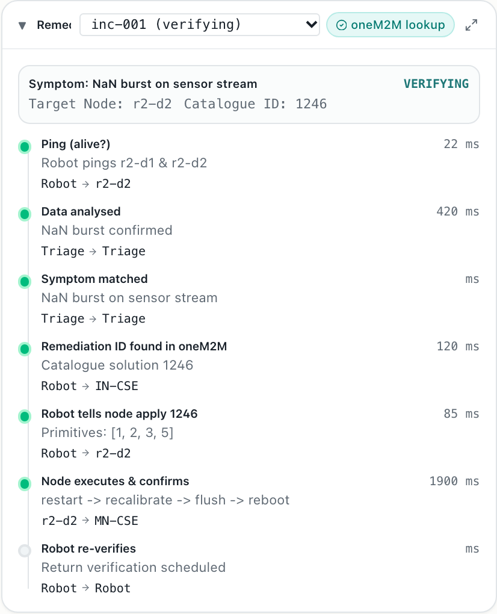

---

## [Hardware Setup]

### 1. Private 5G Standalone (SA) Laboratory Testbed
- **5G gNodeB**: WiSig Networks CU-DU software running on Ubuntu 22.04 LTS RT kernel.
- **Radio Unit (RU)**: VVDN Low Power RU operating in 5G NR Band n78 (TDD, 100 MHz channel bandwidth, 30 kHz subcarrier spacing).
- **Core Network (5GC)**: NiralOS Rel-16 cloud-native containerized 5G Core with local UPF breakout to edge servers.
- **Cellular Modem**: Quectel RM500Q-GL connected to Raspberry Pi 5 USB 3.0, registered to the 5G SA network with a dedicated SIM profile.

### 2. Edge Compute Infrastructure
- Dual Intel Xeon Gold 6338, 128 GB RAM, running Ubuntu Server 22.04 LTS.
- Hosts ACME IN-CSE and two MN-CSEs representing geographical districts (District A and District B).

### 3. Swarm & Robot Hardware
- **Robot Doctor**: Raspberry Pi 5 (8GB RAM), active cooler, 5G modem HAT, wide-angle inspection camera, and motor chassis.
- **Sensor Swarm**: 4x ESP32 DevKit v1 boards distributed across Room 1, Room 2, Room 3, and Room 4.

---

## [Software Setup]

### 1. Multi-CSE Topology Configuration
The ACME CSE topology is configured via standalone `acme.ini` instances in `cse_configs/`:
- `cse_configs/in_cse/acme.ini` (Port 8080, `cse-in`, `/id-in`)
- `cse_configs/district_a/acme.ini` (Port 8081, `DistrictA-MN-CSE`, `/id-mn-a`)
- `cse_configs/district_b/acme.ini` (Port 8082, `DistrictB-MN-CSE`, `/id-mn-b`)

Each instance has its native Web UI enabled:
```ini
[webui]
enable = true
root = /
```

### 2. Running the Complete System
```bash
# 1. Start all 3 ACME CSE instances
python3 scripts/run_topology.py start

# 2. Bootstrap oneM2M resource tree (ACPs, catalogs, flexContainers, polling channels)
python3 api/bootstrap_acme.py

# 3. Start FastAPI streaming gateway and WebSocket engine
python3 -m uvicorn api.main:app --host 0.0.0.0 --port 8000

# 4. Start React Digital Twin Dashboard
npm run dev -- --port 5173
```

---

## [oneM2M Usage]

### Complete Resource Type (`ty`) Mapping in ACME CSE

```
<CSEBase> (cse-in, ty=5)
│
├── <accessControlPolicy> (acp-sensors-write, ty=1)
├── <accessControlPolicy> (acp-robot-exec, ty=1)
├── <accessControlPolicy> (acp-llm-propose, ty=1) [acop: 35]
├── <accessControlPolicy> (acp-operator-approve, ty=1)
│
├── <container> (remediationCatalog, ty=3)
│   ├── <contentInstance> (1246: steps [1,2,3,5], ty=4)
│   ├── <contentInstance> (1310: steps [2,3,4], ty=4)
│   ├── <contentInstance> (1408: steps [1,4,5], ty=4)
│   └── <contentInstance> (1602: steps [1,2,3,4,5], ty=4)
│
├── <remoteCSE> (id-mn-a, ty=16) ---> Points to DistrictA-MN-CSE (:8081)
└── <remoteCSE> (id-mn-b, ty=16) ---> Points to DistrictB-MN-CSE (:8082)

<CSEBase> (DistrictA-MN-CSE, ty=5)
│
├── <flexContainer> (radioInfo, ty=28, cnd="custom:mecRadioInfo")
│   └── Attributes: rsrp, sinr, cqi, mcs, bler
│
├── <flexContainer> (swarmGroup, ty=28, cnd="custom:swarmMembership")
│   └── Attributes: activeNodes, batteryLevels, healthStates
│
├── <AE> (RobotAE, ty=2)
│   ├── <pollingChannel> (pollingChannel, ty=15)
│   │   └── <pollingChannelURI> (pcu, virtual resource)
│   └── <container> (tasks, ty=3)
│
└── <AE> (Room2, ty=2)
    └── <container> (telemetry, ty=3)
        └── <contentInstance> (cin, ty=4)
```

### 1. Access Control Policy (ACP) Enforcement
When `MissionAE` (the edge LLM) attempts to execute a direct hardware reboot command, ACME evaluates `acp-llm-propose`:
```http
POST /DistrictA-MN-CSE/RobotAE/mgmtObj HTTP/1.1
Host: 127.0.0.1:8081
X-M2M-Origin: MissionAE
X-M2M-RI: ri-hero-acp-block
X-M2M-RVI: 4
Content-Type: application/json;ty=13

{"m2m:nod": {"rn": "reboot_node"}}
```
**ACME CSE Immediate Response**:
```http
HTTP/1.1 403 Forbidden
X-M2M-RSC: 4103
Content-Type: application/json

{"m2m:dbg": "Originator has no privilege for target resource"}
```

### 2. ETSI TR-0077 5G Radio `<flexContainer>` (`ty=28`)
```json
{
  "custom:mecRadioInfo": {
    "rn": "radioInfo",
    "ty": 28,
    "cnd": "custom:mecRadioInfo",
    "rsrp": -88.0,
    "sinr": 18.0,
    "cqi": 15,
    "mcs": 28,
    "bler": 0.001,
    "pi": "id-mn-a",
    "ri": "mecRadioInfo4RVE1gCdVR"
  }
}
```

### 3. Asynchronous NAT Traversal via `<pollingChannel>` (`ty=15`)
The mobile robot, operating behind carrier-grade NAT, issues a persistent HTTP long-poll:
```http
GET /DistrictA-MN-CSE/RobotAE/pollingChannel/pcu HTTP/1.1
Host: 127.0.0.1:8081
X-M2M-Origin: RobotAE
X-M2M-RI: ri-robot-poll-001
X-M2M-RVI: 4
```
When a task flexContainer is created under `tasks`, ACME immediately fulfills the poll request and delivers the payload to the robot.

---

## [Dashboard]

The SwarmLink-M2M Dashboard is a dedicated **Digital Twin projection** designed to verify ACME's authoritative role:

| ACME CSE Authority (The Ground Truth) | Dashboard Digital Twin (Projection) |
| :--- | :--- |
| **ACME ACP Resource**: `acp-llm-propose` (`ty=1`) returning `4103 Forbidden` | **Security Tray & AI Guardrail Stream**: Visualizes active ACP privileges and captures real-time 4103 rejection logs. |
| **ACME flexContainer**: `/DistrictA-MN-CSE/radioInfo` (`ty=28`) | **5G Link & Handover Monitor**: Dynamic RSRP/SINR sparklines plotting signal degradation against the $-105\text{ dBm}$ threshold. |
| **ACME CSEBase Trees**: Three CSEs across ports 8080, 8081, 8082 | **oneM2M Resource Tree Explorer**: Live hierarchical tree explorer with 2.5s teal flash highlight pulses on updates. |
| **ACME Catalog**: `/cse-in/remediationCatalog` (`ty=3`, `ty=4`) | **Remediation Timeline & Catalogue Reference**: Step-by-step diagnostic chain tracker (`1: restart`, `2: recalibrate`, etc.). |
| **ACME Polling Channel**: `<pollingChannel>/pcu` (`ty=15`) | **Unified Live Traffic Stream**: Inspects HTTP wire operations and X-M2M headers in real time. |


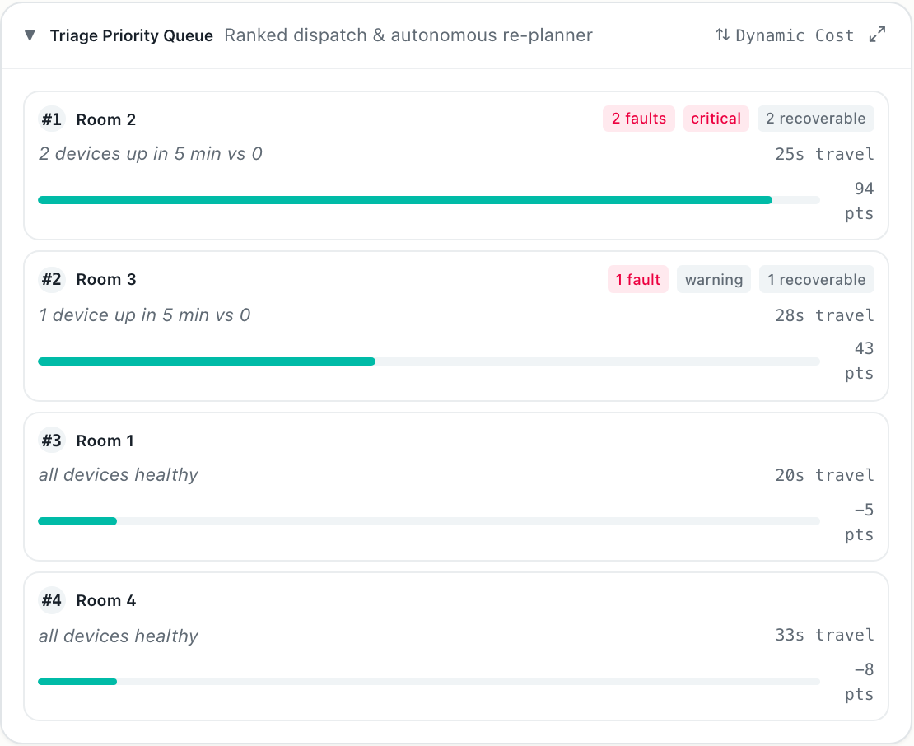
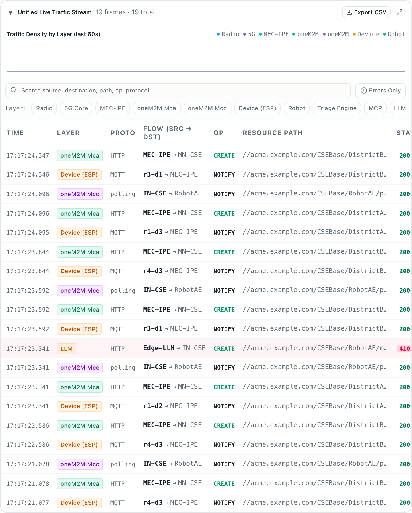
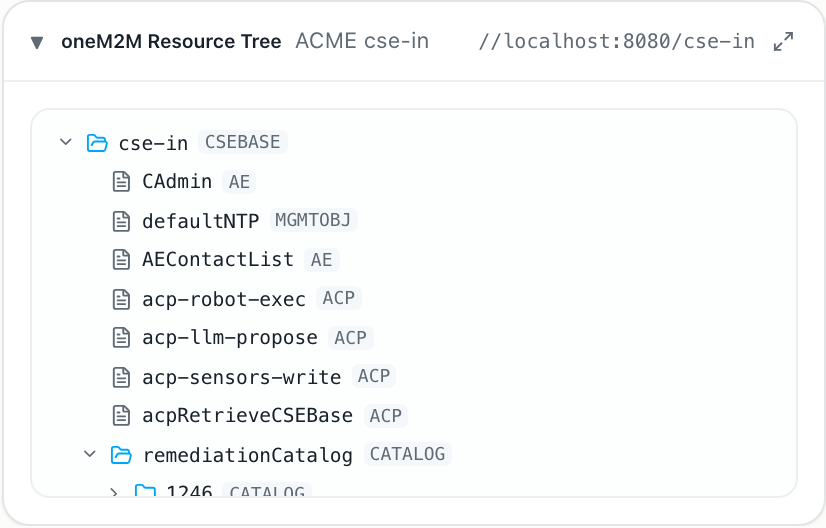

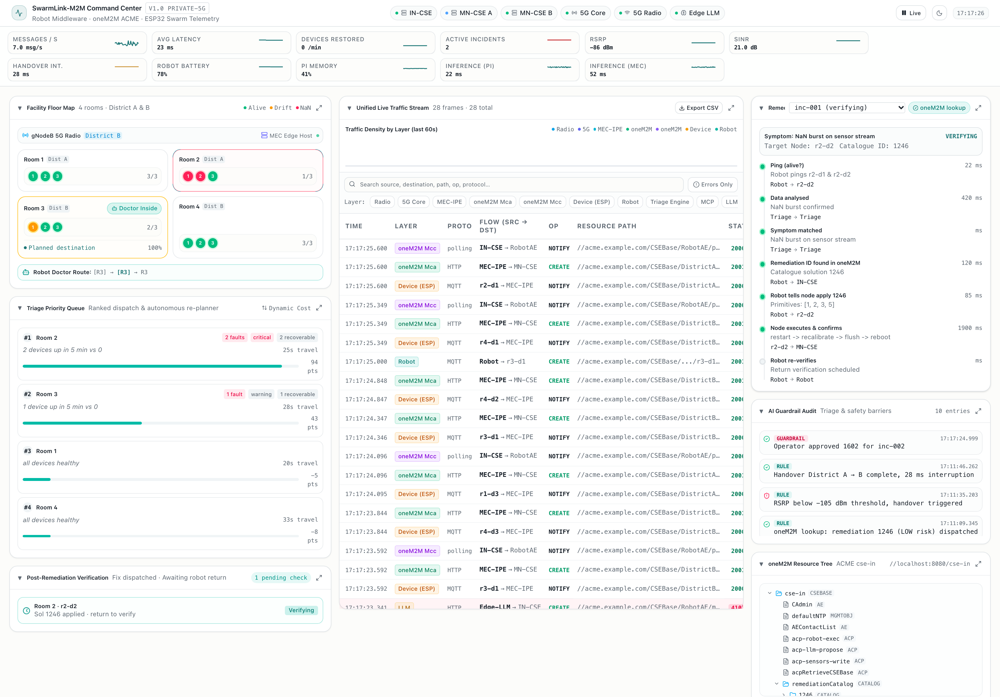

---

## [Conclusion]

SwarmLink-M2M establishes a new benchmark for autonomous robotics operating over private 5G networks by demonstrating that the **oneM2M standard is uniquely suited to govern edge swarms**:
1. **Indispensability Validated**: Replacing proprietary IoT message buses with ACME CSE gives swarms standardized security (ACPs), native NAT traversal (pollingChannel), and resilient edge federation (Mcc).
2. **Standardization Contributions Realized**:
   - Proposed and verified concrete TR-0077 Clause 7.1 MEC-IPE architecture using `<flexContainer>` specialization `[custom:mecRadioInfo]`.
   - Realized the TR-0077 Clause 7.2 IN-CSE Handover Orchestrator actor for inter-MN-CSE handovers.
   - Formulated concrete data models for TR-0077 Clause 7.4 Swarm Computing (`[swarmMembership]`, `[swarmTask]`, `[swarmContext]`).
3. **Reproducibility**: The complete system is verified by automated test suites spanning pure HTTP wire verification and full browser end-to-end tests.

---

## [Schematics]

### 1. End-to-End System Architecture

```
+-----------------------------------------------------------------------------------------+
|                                COMMAND / CLOUD TIER                                      |
|                                                                                         |
|       +-------------------------------------------------------------------------+       |
|       |                     ACME IN-CSE (:8080, cse-in)                         |       |
|       |  - Access Control Policies (acp-sensors-write, acp-robot-exec, etc.)    |       |
|       |  - Global Remediation Catalog (/remediationCatalog/1246, 1310, ...)     |       |
|       |  - IN-CSE Handover Orchestrator Actor (ETSI TR-0077 Clause 7.2)         |       |
|       +-------------------------------------------------------------------------+       |
|                       ^                                         ^                       |
|                       | Mcc Reference Point                     | Mcc Reference Point   |
|                       v (:8080 <-> :8081)                       v (:8080 <-> :8082)     |
+-----------------------------------------------------------------------------------------+
|                       |                                         |                       |
|                       |                                         |                       |
+-----------------------------------+     +-----------------------------------------------+
|      EDGE DISTRICT A (MEC)        |     |             EDGE DISTRICT B (MEC)             |
|                                   |     |                                               |
|  +-----------------------------+  |     |  +-----------------------------------------+  |
|  | ACME MN-CSE (:8081, id-mn-a)|  |     |  |     ACME MN-CSE (:8082, id-mn-b)        |  |
|  | - [custom:mecRadioInfo]     |  |     |  | - Standby Handover Target Node          |  |
|  | - [swarmMembership]         |  |     |  | - District B Rooms (Room 3, Room 4)     |  |
|  | - RobotAE & pollingChannel  |  |     |  +-----------------------------------------+  |
|  +-----------------------------+  |     +-----------------------------------------------+
|                ^                  |
|                | Mca (HTTP / 5G)  |
|                v                  |
|  +-----------------------------+  |
|  |     MEC-IPE (api/mec_ipe.py)|  |
|  | - Maps 5G RSRP/SINR metrics |  |
|  +-----------------------------+  |
+-----------------------------------+
                 ^
                 | 5G Standalone Radio Access Network (3.5 GHz n78)
                 v
+-----------------------------------------------------------------------------------------+
|                               FIELD ROBOT & SWARM TIER                                  |
|                                                                                         |
|  +-------------------------------------+       +-------------------------------------+  |
|  |  Robot Doctor (Raspberry Pi 5 + 5G) |       |     Dumb ESP32 Sensor Swarm Nodes   |  |
|  |  - Long-polls via /pollingChannel   | <---> |  - Room 1, Room 2, Room 3, Room 4   |  |
|  |  - Dispatches Primitive Actions     |       |  - Execute primitives [1, 2, 3, 5]  |  |
|  +-------------------------------------+       +-------------------------------------+  |
+-----------------------------------------------------------------------------------------+
```

### 2. Signal-Triggered Handover Callflow (ETSI TR-0077 Clause 7.2)

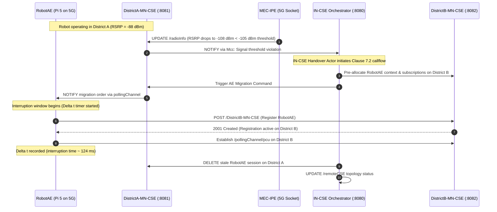

---

## [Code]

All code is fully runnable, modular, and committed in the repository. Key implementation modules:

### 1. Topology Lifecycle Manager (`scripts/run_topology.py`)
Spawns and monitors the three independent ACME CSE instances across ports 8080, 8081, and 8082 with automated PID tracking and port conflict resolution.

### 2. oneM2M Bootstrap Script (`api/bootstrap_acme.py`)
Populates the complete oneM2M hierarchy via pure standard HTTP calls:
- Creates global ACPs (`acp-sensors-write`, `acp-robot-exec`, `acp-llm-propose`, `acp-operator-approve`).
- Populates `/cse-in/remediationCatalog` contentInstances with primitive recovery chains.
- Initializes `<flexContainer>` specialization `[custom:mecRadioInfo]` under `DistrictA-MN-CSE`.
- Creates `RobotAE` and `<pollingChannel>` with virtual `/pcu` resource.

### 3. MEC-IPE Radio Telemetry Adapter (`api/mec_ipe.py`)
Connects to 5G RAN/Core metrics sockets, serializes RF parameters, and performs standard oneM2M UPDATE requests to ACME flexContainers:
```python
def update_mec_radio_info(cse_url: str, rsrp: float, sinr: float, cqi: int, mcs: int, bler: float):
    url = f"{cse_url}/DistrictA-MN-CSE/radioInfo"
    headers = {
        "X-M2M-Origin": "CAdmin",
        "X-M2M-RI": f"ri-mec-{int(time.time()*1000)}",
        "X-M2M-RVI": "4",
        "Content-Type": "application/json"
    }
    payload = {
        "custom:mecRadioInfo": {
            "rsrp": rsrp,
            "sinr": sinr,
            "cqi": cqi,
            "mcs": mcs,
            "bler": bler
        }
    }
    return requests.put(url, json=payload, headers=headers)
```

### 4. Pure oneM2M Protocol Verification Suite (`scripts/verify_acme_pure_onem2m.py`)
Executes direct wire checks against running ACME CSEs, proving that ACP security rejections (4103 Forbidden) and flexContainers operate strictly according to spec.

---

## [Credits]

- **Team Nexus**:
  - **Likhith Kanigolla** ([IN] Nexus): System Architecture, oneM2M Integration, ACME Multi-CSE Orchestration, Digital Twin Dashboard.
  - **Lokabhiram** ([IN] Nexus): Private 5G Standalone RAN (WiSig CU-DU) & 5G Core (NiralOS), MEC Telemetry, RF Performance Benchmarking.
- **Special Thanks & Mentorship**:
  - **Bob Flynn** (oneM2M System Architect, ETSI ESTIMED): Expert guidance on TR-0077 Clauses 7.1, 7.2, 7.4, and the "Remove the CSE and nothing works" architecture.
  - **Yann Garcia** (ETSI MEC Specialist): Consultation on Multi-access Edge Computing integration and MEC-IPE data path design.
  - **Andreas Kraft**: Author of ACME CSE, the foundational reference platform powering our entire system.
- **Affiliation**: oneM2M Hackathon (ETSI STF 685 ESTIMED Track).
